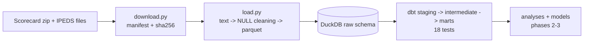

# Campus Pulse

Higher-education outcomes analytics on free US government data: College Scorecard and IPEDS in a DuckDB warehouse modeled with dbt,
SQL analyses with proper statistics, earnings models with SHAP, and a four-page Streamlit dashboard.

*Phases 2-4 are still to come; this README is updated after each phase.*

## Problem
Families choose colleges with sticker prices and rankings, but the question is what a school delivers for students like theirs:
earnings, completion and debt. The Scorecard publishes this for thousands of institutions, but in files with 3,000+ columns, mixed
missing-value codes and changing layouts. This project makes it queryable and tests four questions:
1. Does paying more buy higher earnings?
2. Which sectors finish what they start, and at what debt cost?
3. How do Florida public universities compare with peers, and who over- or under-performs?
4. What predicts earnings, and how well for institutions the model has never seen?

## Architecture

Raw files are read as text, cleaned in one place, loaded to DuckDB and modeled by dbt at institution-year grain.

## Tech stack
| Tool | Used for | Why |
|---|---|---|
| Python 3.12, pandas | download and load | streaming zip reads, simple text cleaning |
| DuckDB | warehouse | file database, fast analytics SQL, no server or container |
| dbt-duckdb | modeling and tests | lineage, documented columns, tests as code |
| pytest, ruff | quality | fast checks on every commit |
| GitHub Actions | CI | runs the offline fixture check |

## Quick start
Prerequisites: Python 3.12, `uv`. About 600 MB of downloads.
```bash
uv venv --python 3.12 && uv pip install -r requirements.txt
./scripts/check.sh --fixture   # offline, uses data/fixtures
./scripts/check.sh             # real data (downloads once)
```

## Results
See [RESULTS.md](RESULTS.md) (generated, each number with its command). Phase 1: 6 releases, 9,536 institutions, 44,408 institution-years.

## How it works
- **Release choice by measurement.** Only some Scorecard releases populate 10-year earnings; I counted them (DECISIONS D-02).
- **Missing-value strings.** `NULL`, `PrivacySuppressed`, `PS`, `NA` all become NULL and suppression is counted per column.
- **Idempotent load.** Tables rebuild in one transaction; a test compares checksums across two runs.

## Testing
`pytest` (5 tests) and `dbt build` (18 data tests). `scripts/check.sh --fixture` runs both offline.

## Design decisions and trade-offs
See [DECISIONS.md](DECISIONS.md). Top three: earnings releases are not the newest ones; Carnegie comes from IPEDS because Scorecard's
is empty; no Power BI/Tableau (Windows-only / account), Streamlit instead.

## Known limits and next steps
Earnings describe a cohort that entered about a decade before the release. Dollars are nominal. Suppression removes small institutions.

## Project structure
```
campuspulse/  download, load, config, warehouse_stats, results
dbt/          models (staging, intermediate, marts), seeds, custom tests
scripts/      check.sh, refresh.sh, build_dictionary.py, make_fixture.py
data/fixtures committed 399-institution sample
docs/         data-dictionary.md, INTERVIEW-NOTES.md, pr/
```
