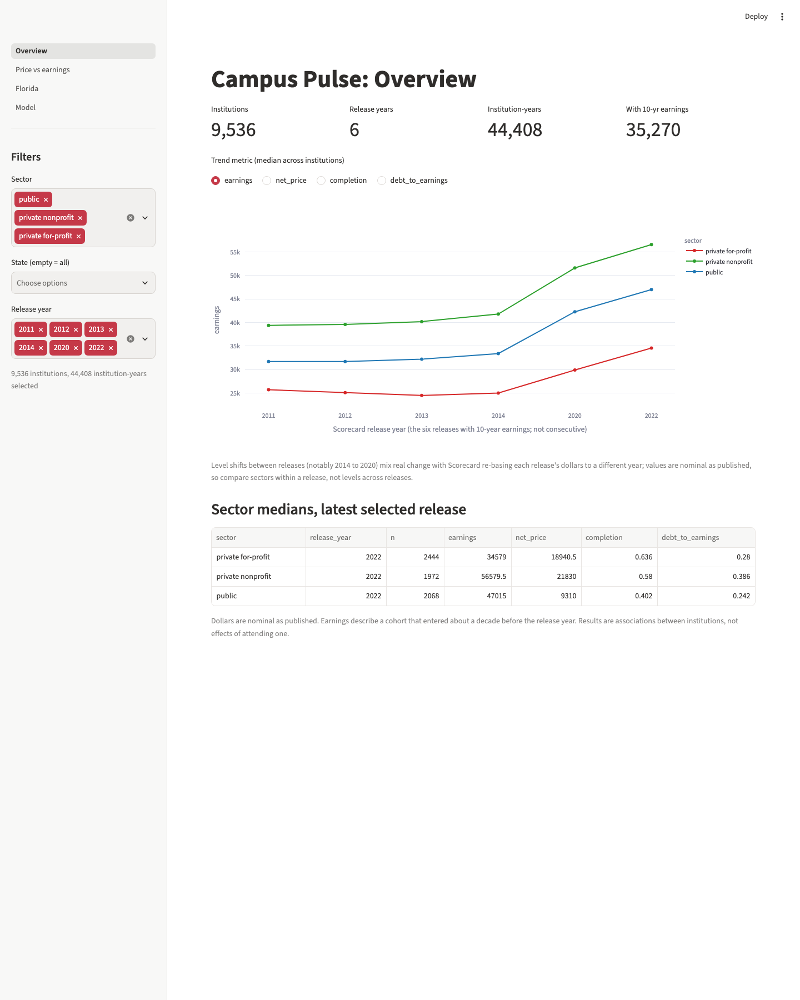
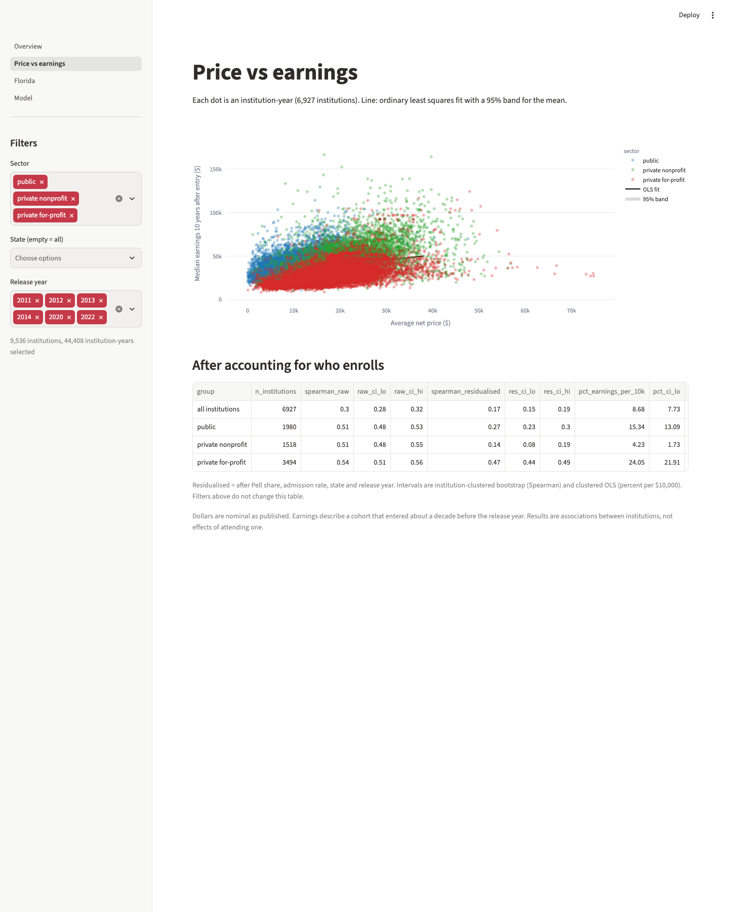
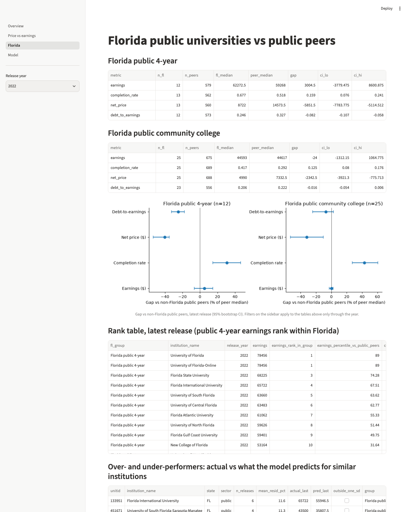
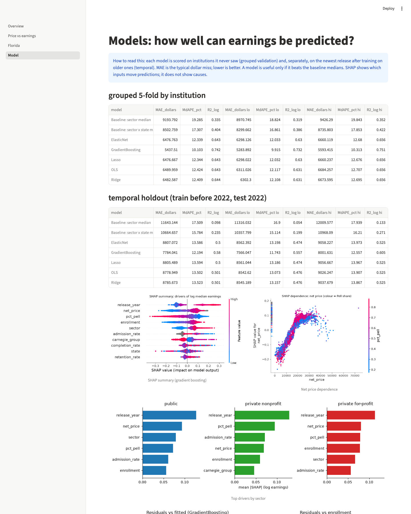
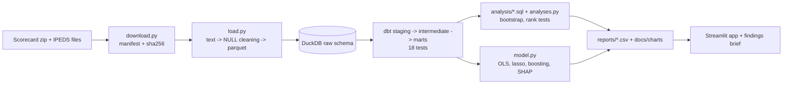

# Campus Pulse


Higher-education outcomes analytics on College Scorecard and IPEDS open data: 9,536 US institutions in a DuckDB warehouse modeled with dbt,
four questions answered in SQL with proper statistics, earnings models with SHAP, and a four-page Streamlit dashboard. `make refresh` rebuilds everything from raw data.

## Problem
Families choose colleges by sticker price and rankings, but the useful question is what a school delivers for students like theirs: earnings, completion and debt.
The Scorecard publishes this for thousands of institutions, but in files with 3,000+ columns, mixed missing-value codes and changing layouts. This project makes it queryable and tests four questions,
for a high-school counselor or parent as the reader:
1. Does paying more buy higher earnings? (net price vs median earnings, after controlling for who enrolls)
2. Which sectors finish what they start, and at what debt cost?
3. How do Florida public universities compare with public peers nationally, and who over- or under-performs what their student mix predicts?
4. What actually predicts earnings, and how well can we predict it for institutions the model has never seen?

## Demo
One screenshot per dashboard page (taken by `scripts/screenshots.py`), and the one-page brief: [docs/findings.md](docs/findings.md) / [PDF](docs/findings.pdf).

| Overview | Price vs earnings |
|---|---|
|  |  |
| **Florida** | **Model** |
|  |  |

Run it locally: `streamlit run app/streamlit_app.py` (reads only committed files in `reports/`, so it works from a fresh clone).

## Architecture

Raw files are read as text, cleaned in one place and loaded to DuckDB. dbt builds an institution-year fact table with documented columns and tests. SQL files and a modeling script read the marts and write CSVs and charts to `reports/` and `docs/charts/`; the dashboard and the brief read only those outputs.

## Tech stack
| Tool | Used for | Why I chose it |
|---|---|---|
| Python 3.12, pandas | download, load, statistics | streaming zip reads, simple text cleaning |
| DuckDB | warehouse | file database, fast analytical SQL, no server or container |
| dbt-duckdb | modeling, tests, docs | lineage, documented columns, tests as code |
| statsmodels, SciPy | OLS with robust SE, rank tests | proper inference and intervals |
| scikit-learn | ridge/lasso/elastic net, gradient boosting | `HistGradientBoostingRegressor` is deterministic and has no extra native dependency |
| SHAP | explanations | model-agnostic importance, checked for additivity |
| Streamlit + Plotly | dashboard | free to host, runs from committed files (Power BI is Windows-only, Tableau Public needs an account) |
| Playwright | screenshots and PDF | headless and reproducible at a fixed viewport |
| pytest, ruff, GitHub Actions | quality | fast checks; CI runs the offline fixture |

## Quick start
Prerequisites: macOS or Linux, Python 3.12, [`uv`](https://docs.astral.sh/uv/), about 600 MB of downloads. No containers.
```bash
uv venv --python 3.12 && uv pip install -r requirements.txt
make refresh                 # download, load, dbt, analyses, models, screenshots, brief (about 3 minutes)
make refresh FIXTURE=1       # same, offline, from the committed 399-institution sample
./scripts/check.sh --fixture # lint + tests + the pipeline on the fixture
```

**Deploy the dashboard (needs a Streamlit account, not done):** push the repo to GitHub, open share.streamlit.io, choose New app, pick this repo, branch `main`, main file `app/streamlit_app.py`,
Python 3.12, and under Advanced set the requirements file to `app/requirements.txt` (four packages, fast build). No secrets are needed.

## Results
Every number is generated by a script (command in the right column); full tables in [RESULTS.md](RESULTS.md).

| Measure | Value | Command |
|---|---|---|
| Scorecard releases | 6 (2011-12, 2012-13, 2013-14, 2014-15, 2020-21, 2022-23) | `python -m campuspulse.warehouse_stats` |
| Institutions, institution-years | 9,536 distinct; 44,408 rows; 35,270 with earnings | same |
| IPEDS match rate; dbt tests | 94.2%; 18 of 18 pass | same |
| Q1 price vs earnings | Spearman 0.30 (0.28 to 0.32); 0.17 (0.15 to 0.19) after controls; +8.7% earnings per $10k net price (7.7% to 9.6%) | `python -m campuspulse.analyses` |
| Q2 completion, 2022 release | median public 40%, nonprofit 58%, for-profit 64%; enrollment-weighted 49%, 64%, 48% | same |
| Q3 Florida public 4-year (n=12) | earnings gap +$3,004 (-$3,779 to $8,601, not distinguishable from 0); completion +15.9 points (7.6 to 24.1) | same |
| Q4 sector differences | earnings Kruskal-Wallis epsilon-squared 0.34 (0.32 to 0.36), n=7,998 | same |
| Q4 prediction, unseen institutions | gradient boosting MAE $5,438 (5,284 to 5,593), R2(log) 0.74, vs $8,503 for sector x state median | `python -m campuspulse.model` |
| Prediction on the 2022 release | MAE $7,784 (7,566 to 8,002) vs $10,665 baseline | same |
| Full refresh wall time | 163 s on an M3 / 16 GB | `make refresh` |

## How it works
- **Release choice by measurement.** 10-year earnings exist in only 8 of 20 recent Scorecard files and not in the newest four, so the six releases are the most recent ones that have them (DECISIONS D-02).
- **Missing-value strings.** `NULL`, `PrivacySuppressed`, `PS`, `NA` all become NULL; suppression (about 11% of earnings, 18% of completer debt) is counted per column and release.
- **Clustered bootstrap.** Institutions appear in several releases with overlapping cohorts, so intervals resample whole institutions (seeded and reproducible).
- **Honest validation.** Institution-grouped folds and a 2022 temporal holdout, scored against same-year baselines; a leakage test and a permuted-target test guard the features.
- **SHAP that adds up.** SHAP additivity is asserted; sklearn's native categorical splits were mis-attributed, so categoricals are ordinal-coded (D-11).

## Testing
```bash
.venv/bin/pytest -q              # 17 tests
cd dbt && ../.venv/bin/dbt build --profiles-dir .   # 10 models, 1 seed, 18 data tests
```
pytest covers link scraping, sentinel cleaning, idempotent loads, SQL results vs an independent pandas recomputation (4 queries), seeded bootstrap reproducibility, leakage, fold integrity and SHAP additivity.
dbt tests cover unique/not-null keys, relationships, accepted values and ranges, per-release row floors and the IPEDS match rate. CI runs `scripts/check.sh --fixture` offline.

## Design decisions and trade-offs
Full log in [DECISIONS.md](DECISIONS.md). Top three:
1. **Earnings releases are not the newest ones** (D-02): the years are 2011-2014, 2020 and 2022; trend charts say so and dollars stay nominal with release-year fixed effects.
2. **Gradient boosting chosen by validation** (D-11), with linear models kept for inference; boosting categoricals are ordinal-coded so SHAP is correct.
3. **No Power BI or Tableau** (D-08): Streamlit runs from committed files and can be hosted free.

## Known limits and next steps
- Association, not causation: earnings reflect who enrolls; controls are proxies. Earnings describe a cohort that entered about a decade before each release; dollars are nominal.
- Suppression removes small institutions and some for-profit schools, so results describe institutions big enough to report.
- Florida has 12 public universities with earnings data, so intervals are wide; "University of Florida-Online" shares the main campus's earnings record.
- The 2022 temporal holdout re-uses institutions, so it is a time test, not an unseen-institution test; the 2022 dollar base is assumed to match 2020-21.
- Next: Streamlit Cloud deploy, an extra IPEDS-based control (e.g. program mix), and CPI-deflated dollars as a sensitivity check.

## Project structure
```
campuspulse/   download, load, config, warehouse_stats, analyses, stats, model, results
analysis/      four SQL analyses
dbt/           models (staging, intermediate, marts), seeds, custom tests
app/           Streamlit dashboard (four pages)
scripts/       check.sh, refresh.sh, build_dictionary.py, build_findings.py, screenshots.py, make_fixture.py
data/fixtures/ committed 399-institution sample (0.9 MB)
reports/       CSV/JSON outputs read by the app; findings_auto.md
docs/          data-dictionary.md, findings.md/pdf, screenshots, charts/, INTERVIEW-NOTES.md, pr/
RESULTS.md, DECISIONS.md, PROGRESS.md
```
